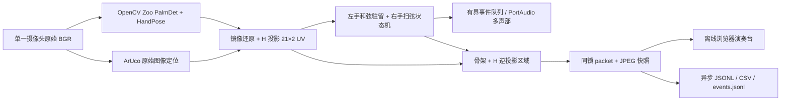

# Version note (2026-10-22)

This document describes the schema-2 compatibility endpoints. New native endpoints,
`/api/snapshot` and recordings use schema 3; see [generalized plane API](../generalized/API.md).
Unversioned `/api/landmarks` and `/api/state` retain schema 2 through an explicit adapter.

# Schema v2 与运行边界

唯一入口 `app.py`，正式模式的数据流：



浏览器没有手部模型、摄像头采集、Homography 求解或音频播放逻辑。OpenCV Zoo 模型名称包含 mediapipe，是保留的 ONNX 模型来源，不代表运行第二套 MediaPipe runtime。

## HTTP

| 方法和路径 | 内容 |
| --- | --- |
| GET `/` | 单一正式演奏台；JS/CSS 本地加载 |
| GET `/api/landmarks` | 最新 packet + 服务元数据，保留原路径 |
| GET `/api/state` | 同上，兼容别名 |
| GET `/api/snapshot` | `{packet, image_base64}`；图像与感知/交互来自同一帧；网页使用此路径 |
| GET `/frame.jpg` | 最新已叠加 JPEG；`X-Frame-Id` 响应头；无图像时 503 |
| POST `/api/record/start` | 启动录制，非 running 时 409 |
| POST `/api/record/stop` | 停止接收并排空录制队列，返回最新状态 |
| POST `/api/shutdown` | 停止采集、释放设备、关闭服务器 |

每次 API 读取不消费音乐事件。HTTP 最新帧覆盖旧帧，低频轮询允许跳帧。**独立调用 JSON 和 JPEG 可能跨帧**，需要严格对齐时使用 `/api/snapshot`，不要在前端把另一个帧的节点叠在 JPEG 上。音频统计反映查询时的最新回调状态，感知与交互仍绑定快照帧。

默认绑定 `127.0.0.1:8765`。远程查看须显式 `--host`；远端 POST 默认 403，使用 SSH 转发或明确启用 `--allow-remote-controls`。无认证，不适合公网。已有同源 Origin 校验保留，并拒绝 `Sec-Fetch-Site: cross-site`。

## Packet

完整、未缩写且真实运行生成的示例：[schema-v2.synthetic.json](schema-v2.synthetic.json)。**该例是合成手部 + 实际 ArUco 检测的模拟输入，不是真人采集**；两手均有 21×3 原数组和 21×2 UV。复现命令见 TEST_REPORT。

| 字段 | 约定 |
| --- | --- |
| schema_version | 服务为 2；独立 HandTracker 原接口仍返回 1，再由融合层升级 |
| status | starting/running/error/stopped，服务状态；板状态单独在 instrument |
| frame_id | 处理帧号，进程内递增 |
| timestamp_unix_s | 原始帧读取完成时 wall clock；用于外部显示/录制 |
| timestamp_monotonic_s | 同一次采集的高精度单调秒（timing.monotonic_s / perf_counter）；仅在该时钟域比较，不能混用 time.monotonic 的 epoch |
| frame_width / frame_height | 原始/显示图像实际尺寸 |
| mirrored | hands.landmarks_px 与 normalized 均属于显示坐标，默认镜像 |
| inference_ms / vision_total_ms | 原手模型耗时 / 手模型 + ArUco + 投影耗时；不等于动作到声音延迟 |
| fps | 服务处理帧率；不包含传感器/显示器实际延迟测量 |
| hands | 当帧手数组，无手 `[]`；最多两手 |
| handedness / handedness_score | 解剖学 Left/Right 及分类置信度；Left 始终选和弦，Right 始终扫弦 |
| track_id / confidence / palm_confidence / bbox_px | 原 A 字段保留；track_id 为短时空间关联，不是永久身份 |
| landmarks_px | 21×3 `[x_px,y_px,z_relative_px]` |
| landmarks_normalized | 21×3 `[x/width,y/height,z/width]` |
| landmarks_world_m | 21×3，模型局部手坐标，不能测板面距离或双手间全局距离 |
| landmarks_instrument_uv | 21×2 板面二维投影；不截断；无有效投影为 null |
| projection_status | valid/unavailable；held 的投影可用于显示，不能演奏 |
| landmark_names / connections | 保留原 21 节点名称及骨架连接 |
| layout | Python 唯一布局定义；含 name、chords 四多边形、strum 多边形和 axis |
| events / recent_events | 本帧零/一个事件 / 最近最多 32 事件的展示历史 |
| audio_status / audio | ready/mock/disabled/error/closed 及后端、队列、丢弃和消费统计 |
| source | camera/video/synthetic；额外模拟用 static_photo_with_synthetic_markers 明确标记 |
| recording / recording_error / last_recording | 录制状态、显式错误和输出目录 |

所有对外 JSON 使用 `allow_nan=False`；没有可用坐标填 null 而非虚假的零。模型输出的零坐标本身可以是真实数据，模拟示例的局部 world 零数组已由 source/simulation_notice 标记为脚本生成。

## 板面与镜像

ArUco 只看未镜像 BGR，`DICT_4X4_50` 的中心对应 `0→(0,0), 1→(1,0), 2→(0,1), 3→(1,1)`。轮廓遍历 `0,1,3,2`。`instrument` 包含 dictionary、required_ids、visible_ids、各 Marker 的 corners_px_raw/center_px_raw、双向 3×3 H、age、aruco_ms、source_frame_id 和 source_timestamp_monotonic_s。

投影手节点先做 `x_raw = width - 1 - x_display`（镜像时），再应用 camera→instrument H。绘制区域走逆 H，再反射回显示坐标。分母接近零、非有限值和矩阵失效都拒绝；UV 越界不截断。所有区域定义来自 InstrumentLayout，JS 不复制判定常量。

默认和弦区域 `u=[.04,.60],v=[.20,.80]`，四等分为 C/G/Am/F；扫弦区 `u=[.68,.90],v=[.15,.85]`，中线 `v=.5`。`--layout flip-u` 只将区域在 u 方向反射，不改变公开 UV，也不交换解剖学标签。

- valid：四个必需 ID 唯一、凸性/面积/退化校验成功，更新 H 和逆矩阵。
- held：缺标后最多 .25 秒沿用最近 H，仅维持显示，逻辑复位。
- lost：超时、重复必需 ID、退化布局、错误坐标/时间，清空 H；重获后重新观察驻留及一侧轨迹。

Homography 得到的是二维成像投影，手指可以悬空；z 不是板面法向厘米数，不实现触碰判定。

## 交互与事件

`InstrumentLogic.process(packet) -> (state, events)`。state 输出 current_chord、chord_valid、chord_stale、candidate_chord、candidate_since_monotonic_s、strum_state、last_event_id、reason 和可用速度。

左手 MCP 5/9/13/17 均值，默认 100 ms 驻留，边界裕量 .015。丢失/低置信度立即无效，仅允许显示 stale 上次和弦。右手食指尖 8：above ≤.45 → crossing → below ≥.55 发 down，反向发 up；允许采样跨过 crossing 中间帧。最小跨越速度 .6 UV/s，冷却 .18 s。速度按最后同侧样本至对侧样本的 Δv/Δt 计算。velocity = round(1 + 126 × (speed−.6)/(3−.6))，裁剪到 1..127。

过期 >.35 s、相邻帧间隔 >.25 s、ID/左右角色变化、NaN、> .45 UV 突跳或 >12 UV/s 异常速度都会复位；需要重新看到一侧位置后才可扫。所有阈值可通过 `--interaction-config config.json` 覆盖 InteractionConfig 字段；未配置项保留默认。板面 held/lost 或新鲜左手缺失时事件为空。

事件完整形式（数值仅说明契约，运行例见 JSON 文件）：

```json
{"event_id":9,"source_frame_id":123,"timestamp_monotonic_s":24550.125,"direction":"down","chord":"C","velocity":86}
```

event_id 进程内严格递增；direction up/down；chord C/G/Am/F；velocity 整数 1..127。AudioEngine 在有界队列（8）去重，过旧/满队列丢弃并计数，最多 8 重叠声部。ready 只证明输出流就绪；mock 不发声，error 显示原因且视觉继续。event_to_callback_ms 从事件的采集时间戳量到软件回调，不是声学端到端延迟。采集、动作与音频统一使用高精度 perf_counter，避免 Windows Python 3.12 低精度 monotonic 的量化。

## 录制和资源界限

JSONL 包含每个已处理包（含无手帧），CSV 保留原 16 列并追加 instrument_u/v，无法投影留空；events.jsonl 只写本帧新事件一次。单独写线程，队列上限 128；磁盘异常/溢出停止接收并显示 recording_error，不静默宣称完整。停止录制在 HTTP 控制线程排空，音频回调不等待文件。

摄像头只有一个同步采集/处理循环，不引入输入帧积压队列；驱动缓冲数 1 为 best effort，取决于设备。网页核心功能完全离线，字体为本地系统字体。
